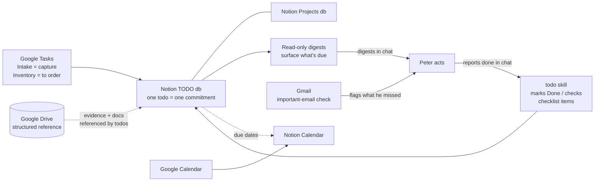
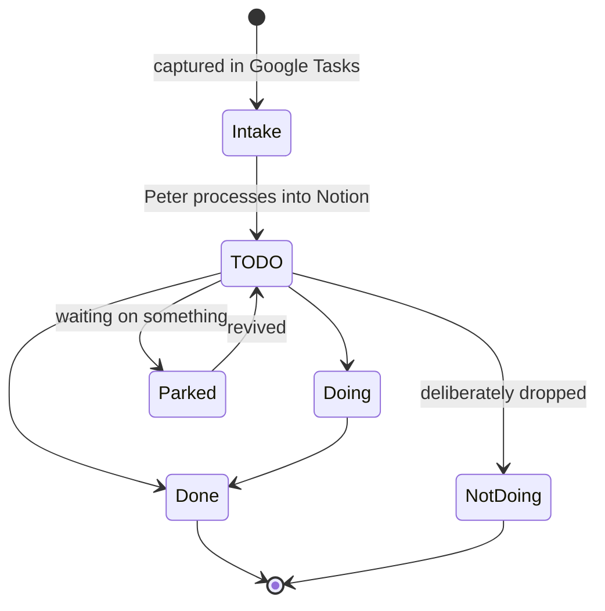

# Peter's GTD system map

How Peter's capture → commitments → follow-through system fits
together. Maintained by Tony. The GTD skills link here so any
session can orient before touching a todo.

## The flow

## The stores

- **Google Tasks — capture.** Intake is the frictionless inbox
  (easy from his phone); Inventory holds things to order. Peter
  processes Intake into Notion himself.
- **Notion TODO database — commitments.** Every todo belongs to a
  Project, may carry a Priority (P0/P1/P2 — Peter triages; new
  todos get none) and a Due date (a real commitment, never a loose
  plan). Todos can block each other (`Blocked by` / `Blocking`).
- **Notion Projects database — the areas.** Each project rolls up
  its todos' % Done.
- **Calendars — where it all surfaces.** Notion Calendar is
  connected to Google Calendar: Google Calendar events flow into
  Notion Calendar, due-dated tasks surface in Google Calendar,
  and Notion todos with due dates show up in Notion Calendar —
  everything floats to the top in one place.
- **Google Drive — structured reference.** The evidence and
  document layer. Not an action list — todos point at Drive
  material, Drive doesn't track work.
- **Gmail — signal source.** The important-email check flags what
  Peter may have missed; anything actionable becomes a todo only
  through Peter.

## Todo lifecycle

Statuses live on the todo: `TODO` (next up) · `Doing` (in flight) ·
`Parked` (waiting) · `Not Doing` (dropped) · `Done` (finished).
A todo's body can hold a checklist — finishing one item checks that
box and the todo stays open (the todo skill owns this).

## Rules that hold it together

- **Chat report = completion signal.** When Peter says it's done,
  the todo skill updates the todo in the same turn.
- **Read-only by default.** Audits and digests never edit; writes
  need his ask or his completion report.
- **Titles are actions.** Details live in the todo body, only if
  needed.
