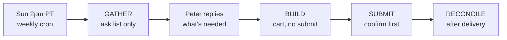
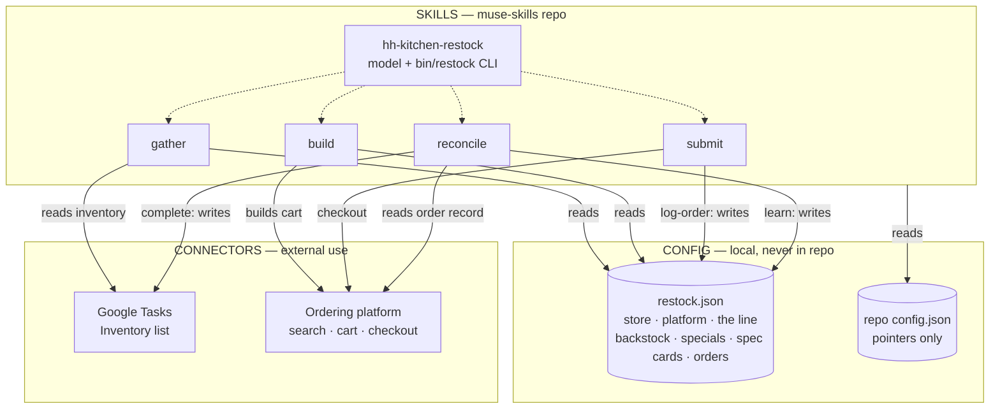

# HH Kitchen Restock — Architecture

Reference only. The SKILL.md files are the playbooks; this doc is
the map, for when the shape of the suite needs checking.

## Flow

## Layers

Skills hold mechanism only. Config is the only state. Connectors
are external use, reached only through their own docs.

- **Config reads:** gather and build read `restock.json`; every
  skill reads the repo `config.json` pointers.
- **Config writes:** only submit (`log-order`) and reconcile
  (`learn`) write `restock.json`.
- **Connector writes:** reconcile is the only skill that writes
  to Google Tasks (`complete`, delivered items only). The
  ordering platform is written by build (cart) and submit
  (checkout), and read back by reconcile (the order record).
